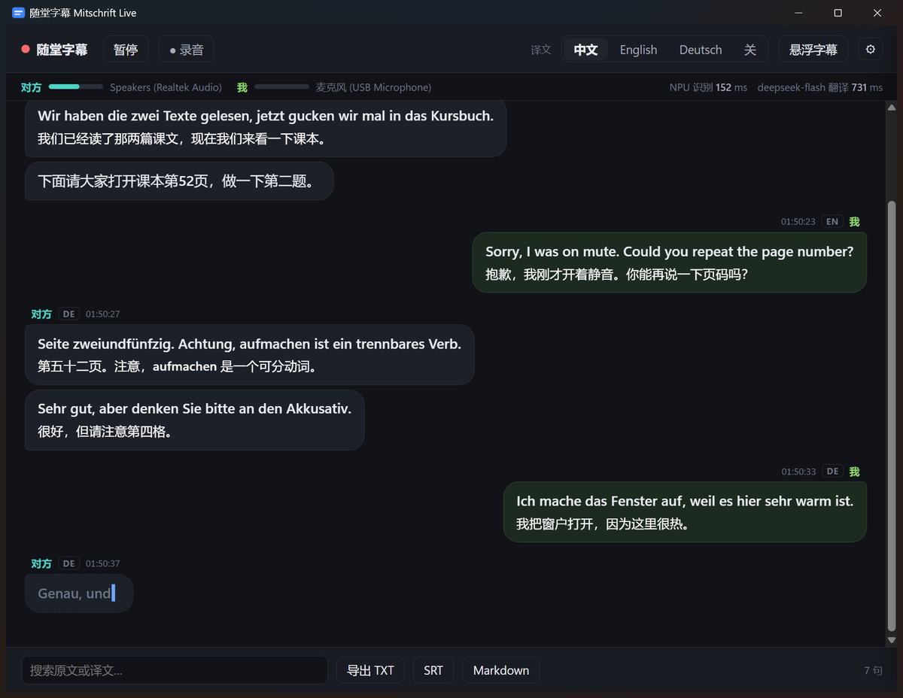
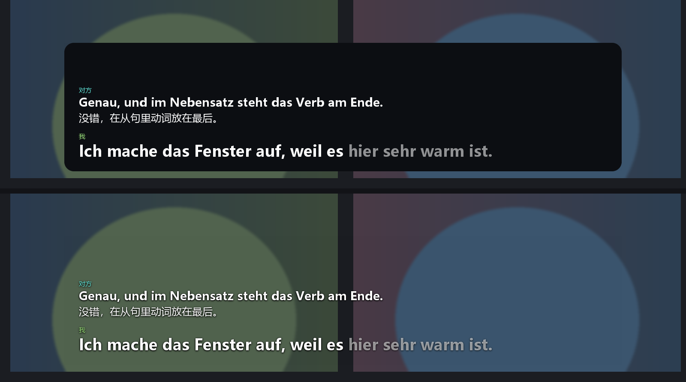

# Mitschrift Live (随堂字幕)

Real-time captions and translation for Windows. Mitschrift Live listens to what your computer
plays (the other side of a Zoom call, a lecture video) and to your microphone, transcribes
both **locally**, and translates every sentence with an LLM. You get a chat-style transcript
and a floating caption bar on top of your call.

*Mitschrift* is German for the notes you take along in a lecture. It was built for a German class taught over Zoom: German, English and Chinese speech,
translated into Chinese, English or German.

[中文说明](README.zh-CN.md)





*The floating caption bar. Text and background opacity are separate settings: opaque by
default (top), or just the text over the call (bottom).*

## Features

- **Two sources, kept apart.** System audio via WASAPI loopback ("对方", the other side) and
  your microphone ("我", you).
- **Local speech recognition.** NVIDIA Parakeet TDT 0.6B v3 (German, English and 23 more
  European languages) on an NVIDIA GPU, an Intel NPU, AMD / Intel integrated graphics
  (DirectML) or the CPU. Chinese is detected per utterance and transcribed by SenseVoice Small.
- **Live, then final.** Words appear while someone speaks and settle into sentences; long
  monologues are cut with a small overlap so no word is lost or doubled.
- **Sentence-by-sentence translation** with the previous lines as context and a "scene" hint
  (default: *a German language class*). DeepSeek or Claude; target 中文 / English / Deutsch, or off.
- **Works with speakers, not just headphones.** WebRTC echo cancellation on the microphone
  (system audio as reference) plus a text-level echo filter.
- **Floating caption bar.** Always on top, never steals focus from Zoom, click-through mode
  with a global hotkey (Ctrl+Alt+L), separate text and background opacity.
- Follows the Windows default devices, records audio + captions on request, exports
  TXT / SRT / Markdown, lives in the tray.

Audio never leaves your computer. Only the text of finished sentences (plus a few previous
lines for context) is sent to the translation provider.

## How it works

```
system audio (loopback) ───────┐
                               ├─> 16 kHz ─> Silero VAD ─> segmenter ─┬─> Parakeet   (de / en / …)
microphone ─> echo cancel ─────┘                                      └─> SenseVoice (zh + language ID)
                                                                               │
                                     captions ─> translator (DeepSeek / Claude) ─> WebSocket ─> main window (WebView2)
                                                                               └─> caption bar (native, per-pixel alpha)
```

- The **segmenter** cuts speech into utterances at pauses, re-transcribes the growing
  utterance every ~0.5 s (less often on slow machines) and forces a cut after ~12 s,
  re-hearing the last word so nothing falls between two pieces.
- **Language routing**: SenseVoice's language ID decides during the first 2.5 s of an
  utterance whether it goes to SenseVoice (Chinese) or Parakeet (everything else).
- The **main window** is a web page in WebView2 talking to the Python backend over a local
  WebSocket (random port + token). The **caption bar** is drawn natively (Pillow + numpy,
  `UpdateLayeredWindow`), because a WebView2 window can only be see-through as a whole.

## Speech engines

Measured on the development machine (Intel Core Ultra 9 275HX, RTX 5080 Laptop) unless noted.
"One 10 s segment" is the time to transcribe a 10-second utterance; CPU use is the share of
the whole machine during a two-stream real-time simulation.

| Engine | Runs on | Encoder | One 10 s segment | CPU use | Notes |
|---|---|---|---|---|---|
| `cuda` | NVIDIA GPU (RTX 5080 Laptop) | fp32 | 66 ms | ~2 % | ~4 GB VRAM |
| `npu` | Intel NPU (Core Ultra "AI Boost") | int8, OpenVINO | 134 ms | 0.5 % | first start compiles ~1 min (cached); 10 s window |
| `dml` | Intel Graphics, 4 Xe cores | fp16, DirectML | ~200 ms | ~4 % | 10 s window |
| `dml` | AMD Radeon 780M (a user's log) | fp16, DirectML | ~130 ms | ~6 % | |
| `cpu` | 8 threads | int8 | 223 ms | ~10 % | slower machines refresh partial results less often |

Translation latency per sentence: DeepSeek `deepseek-flash` ~0.7 s median, Claude Haiku ~0.9 s.
Raw numbers are in `bench/results/*.json`; how they were made is in [`bench/README.md`](bench/README.md).

## Requirements

- Windows 10 / 11, 64-bit (developed and tested on Windows 11). WebView2 Runtime (built in on Windows 11).
- Python 3.12 and [uv](https://docs.astral.sh/uv/).
- For translation: a [DeepSeek](https://platform.deepseek.com/) or [Anthropic](https://console.anthropic.com/)
  API key. Without one, captions work and translation can be set to off.

## Install and run from source

```bash
git clone <this repository>
cd mitschrift-live
```

Then pick the speech runtime that fits your hardware (exactly one of `cpu` / `cuda` / `dml`;
`npu` is an add-on):

```bash
uv sync --extra cuda
```

```bash
uv sync --extra cpu
```

```bash
uv sync --extra dml
```

```bash
uv sync --extra cpu --extra npu
```

Set a translation key as a user environment variable (the app also reads user-level values
set with `setx` without a re-login):

```bash
setx DEEPSEEK_API_KEY "sk-..."
```

Start the desktop app (`ui.bat` uses the repo's `.venv`):

```bash
ui.bat
```

Other ways to start it:

- `ui.bat --demo`: scripted demo captions, no audio, models or keys needed.
- `ui.bat --autostart`: start capturing right away.
- `run.bat --engine cpu`: captions in the terminal (`run.bat --help` for all options).

Choose the engine in the app under ⚙ → 识别 → 引擎 (`--engine` for `run.bat`).

### Models

Models are downloaded from Hugging Face on first use into `~/.livecapture/models`
(set `LIVECAPTURE_HOME` to move everything the app stores). In mainland China, point
the download at a mirror first, e.g. `set HF_ENDPOINT=https://hf-mirror.com`.

| Engine | Downloads |
|---|---|
| `cpu`, `npu`, `dml` | Parakeet int8 (~0.65 GB) |
| `cuda`, and once for the conversions below | Parakeet fp32 (~2.4 GB) |
| all, with Chinese on | SenseVoice Small int8 (~0.23 GB), Silero VAD (2 MB) |

Two engines want a converted encoder, made once with the scripts in `bench/`
(`uv sync --group bench` first):

- `npu`: full-int8 OpenVINO encoder. Generate calibration speech, then quantize:
  `uv run python bench/make_samples.py bench/audio_calib calib`, then
  `uv run python bench/npu_quantize.py`. Without it the NPU runs an fp16 encoder, slower.
- `dml`: fp16 encoder. `uv run python bench/to_fp16.py` (needs the fp32 model:
  `uv run python -c "from livecapture import models; models.ensure_parakeet(None)"`).
  Without it the app falls back to the CPU.

## Using the app

The interface is in Chinese for now.

- **开始 / 暂停**: start / pause. **中文 / English / Deutsch / 关**: translation target.
- **悬浮字幕**: show / hide the caption bar. Drag it by its body, resize it at its edges; its
  buttons (A− A+ 译文 穿透 ×) appear on hover.
- **穿透** (click-through): clicks go to the window below. Turn it off with **Ctrl+Alt+L**
  (falls back to Ctrl+Alt+C or Ctrl+Alt+F12 if taken; the settings show which).
- **⚙ settings**: engine, translation model and scene, devices (default: follow Windows),
  Chinese detection, echo cancellation, caption bar font size and text / background opacity.
- **● 录音**: record both sides plus captions to `Documents\Mitschrift Live`.
- Closing the window keeps the app running in the tray; quit from the tray menu.

Settings and logs live in `~/.livecapture` (`settings.json`, `ui.json`,
`logs/live-capture.log`). Logs contain timings and errors, not what was said.

## Repository layout

The project was first called *Live Capture*; the Python package (`livecapture`), the data
folder (`~/.livecapture`) and the installer's AppId keep that name so installed copies update
in place.


```
livecapture/      the app
  app.py            desktop shell: main window, caption bar, tray, global hotkey
  server.py         backend: settings, model loading, WebSocket, status / speed log
  pipeline.py       audio sources -> segmenter -> translator, restartable
  audio.py, vad.py  WASAPI capture (loopback + mic), Silero VAD
  segmenter.py      utterances, partial results, forced cuts, language routing
  stt.py            Parakeet on cuda / npu / dml / cpu
  sensevoice.py     Chinese recognition + language ID
  echo.py           echo cancellation and echo filter
  translate.py      DeepSeek / Claude translation
  caption_bar.py    the native floating caption bar
  __main__.py       command-line version (run.bat)
ui/               main window (HTML / JS); overlay.html previews the caption bar in a browser
bench/            benchmarks and experiments behind the design choices
tests/            unit tests (uv run --group dev pytest)
build/            Windows installer tooling (below)
```

## Building Windows installers

`build/build_friends.py` builds a self-contained folder (official embeddable Python,
packages, models) and an [Inno Setup 6](https://jrsoftware.org/isinfo.php) installer per
edition: `--edition cpu`, `npu` (Intel NPU, CPU fallback) or `amd` (DirectML, CPU fallback).
`--patch` builds a small code-only update for installed copies.

These builds embed a DeepSeek API key from `FRIENDS_DEEPSEEK_KEY` so that friends can use
them without an account. The key is only obfuscated and anyone with the installer can
extract it: hand such builds only to people you trust, use a separate key with a spending
limit, and never publish them.

## Known limitations

- Windows only (WASAPI loopback, Win32 windows, DirectML).
- The interface is Chinese only.
- Words of one language inside sentences of another (e.g. German words in Chinese speech)
  are often garbled.
- The `npu` and `dml` engines run a fixed 10 s window, so utterances are cut into ≤10 s pieces.
- On DirectML, int8 is slower than fp16, and declaring the window as a static shape gives
  wrong output (ONNX Runtime 1.24); the code pads instead.
- Installers are not code-signed, so Windows SmartScreen warns about them.

## License

MIT for Mitschrift Live's code, see [`LICENSE`](LICENSE). Models and dependencies have their
own licenses (Parakeet: CC BY 4.0), see [`THIRD_PARTY_NOTICES.md`](THIRD_PARTY_NOTICES.md).
