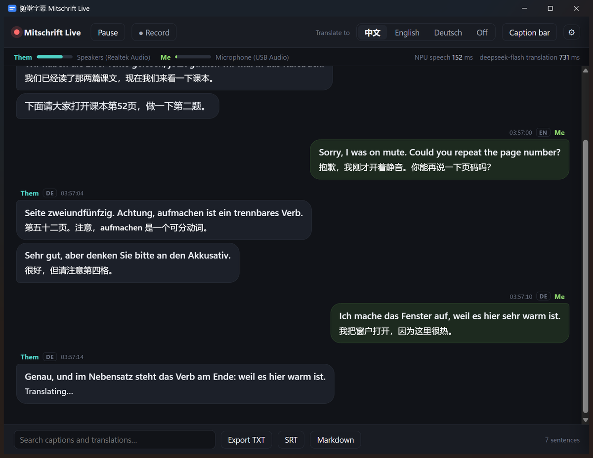

# Mitschrift Live (随堂字幕)

[](https://github.com/QinBojia/mitschrift-live/actions/workflows/tests.yml)

Real-time captions and translation for Windows. Mitschrift Live listens to what your computer
plays (the other side of a Zoom call, a lecture video) and to your microphone, transcribes
both **locally**, and translates every sentence with an LLM. You get a chat-style transcript
and a floating caption bar on top of your call.

*Mitschrift* is German for the notes you take along in a lecture. It was built for a German
class taught over Zoom: German, English and Chinese speech, translated into Chinese, English
or German. The interface is in English and Chinese.

[中文说明](README.zh-CN.md)




*The floating caption bar. Text and background opacity are separate settings: opaque by
default (top), or just the text over the call (bottom).*

## Download

Installers are on the [Releases](https://github.com/QinBojia/mitschrift-live/releases) page.
Pick the edition for your PC; models are included, nothing else to download:

| Edition | For | Size |
|---|---|---|
| **CPU** | any 64-bit Windows 10 / 11 PC (4+ cores recommended) | ~0.65 GB |
| **NPU** | Intel Core Ultra with an NPU; falls back to the CPU | ~1.7 GB |
| **AMD** | integrated graphics through DirectML (AMD Radeon, also Intel); falls back to the CPU | ~1.7 GB |

The installers are not code-signed: Windows SmartScreen asks first ("More info" → "Run
anyway"). They install for the current user only, no admin rights needed. Small
`…-Update.exe` packages update an installed copy of any edition without reinstalling.

For translation, open the app, click ⚙ → Translation and paste a
[DeepSeek](https://platform.deepseek.com/) (default, inexpensive) or
[Anthropic](https://console.anthropic.com/) API key, or a key of an Azure
[Translator](https://learn.microsoft.com/azure/ai-services/translator/) resource (machine
translation, see below). Without a key you still get captions.

## Features

- **Two sources, kept apart.** System audio via WASAPI loopback ("Them") and your
  microphone ("Me"). Either one can be switched off and on while capturing: no microphone
  while you watch a video, or the microphone alone for a lecture in the room.
- **Local speech recognition.** NVIDIA Parakeet TDT 0.6B v3 (German, English and 23 more
  European languages) on an NVIDIA GPU, an Intel NPU, AMD / Intel integrated graphics
  (DirectML) or the CPU. Chinese is detected per utterance and transcribed by SenseVoice Small.
- **Live, then final, sentence by sentence.** Words appear while someone speaks; each
  sentence becomes its own caption about 1.5 s after it ends, even when the speaker doesn't
  pause, and is translated right away.
- **Sentence-by-sentence translation** with the previous lines as context and a "scene" hint
  (default: *a German language class*). DeepSeek, Claude or Microsoft Translator; target 中文 / English / Deutsch, or off.
- **Works with speakers, not just headphones.** WebRTC echo cancellation on the microphone
  (system audio as reference) plus a text-level echo filter.
- **Floating caption bar.** Always on top, never steals focus from Zoom, click-through mode
  with a global hotkey (Ctrl+Alt+L), separate text and background opacity.
- Follows the Windows default devices, records audio + captions on request (including what
  was said before you pressed ● Record), exports
  TXT / SRT / Markdown, lives in the tray. English or Chinese interface (follows Windows).

Audio never leaves your computer. Only the text of finished sentences (plus a few previous
lines for context) is sent to the translation provider. API keys typed into the app are
stored encrypted (Windows DPAPI) for your Windows user.

## How it works

```
system audio (loopback) ───────┐
                               ├─> 16 kHz ─> Silero VAD ─> segmenter ─┬─> Parakeet   (de / en / …)
microphone ─> echo cancel ─────┘                                      └─> SenseVoice (zh + language ID)
                                                                               │
                                     captions ─> translator (DeepSeek / Claude / MS) ─> WebSocket ─> main window (WebView2)
                                                                               └─> caption bar (native, per-pixel alpha)
```

- The **segmenter** cuts speech into utterances at pauses (0.5 s) and re-transcribes the
  growing utterance every ~0.5 s (less often on slow machines). Captions follow sentences:
  once a sentence end has 1.5 s of audio after it, that sentence is committed as a caption
  and recognition continues from its last word, which is heard again so nothing falls
  between the pieces (sentences under three words wait for the next one; after 8 s without
  a sentence end the cut falls on a comma). On a recording of TV dialogue this took the
  90th-percentile caption from 23 words to 14 and the longest from 41 to 22, with unchanged
  accuracy. Speech with no usable sentence end is cut after ~9 s all the same. When a
  recognition leaves out speech that the voice detector heard, it is retried on slightly
  different views of the audio, and words the previous window had already heard are kept.
- **Language routing**: SenseVoice's language ID decides during the first 2.5 s of an
  utterance whether it goes to SenseVoice (Chinese) or Parakeet (everything else).
- The **main window** is a web page in WebView2 talking to the Python backend over a local
  WebSocket (random port + token). The **caption bar** is drawn natively (Pillow + numpy,
  `UpdateLayeredWindow`), because a WebView2 window can only be see-through as a whole.

## Speech engines

Measured on the development machine (Intel Core Ultra 9 275HX, RTX 5080 Laptop) unless noted.
"One 10 s segment" is the time to transcribe a 10-second utterance; CPU use is the share of
the whole machine during a two-stream real-time simulation.

| Engine | Runs on | Encoder | One 10 s segment | CPU use | Notes |
|---|---|---|---|---|---|
| `cuda` | NVIDIA GPU (RTX 5080 Laptop) | fp32 | 66 ms | ~2 % | ~4 GB VRAM |
| `npu` | Intel NPU (Core Ultra "AI Boost") | fp16, OpenVINO | ~155 ms | 0.5 % | first start compiles ~1 min (cached); 10 s window |
| `dml` | Intel Graphics, 4 Xe cores | fp16, DirectML | ~200 ms | ~4 % | 10 s window |
| `dml` | AMD Radeon 780M (a user's log) | fp16, DirectML | ~130 ms | ~6 % | |
| `cpu` | 8 threads | int8, fragile convolutions in fp32 | ~245 ms | ~10 % | slower machines refresh partial results less often |

Quantized encoders are fast but were the weak spot. Accuracy on a real recording (13 minutes
of a TV drama with music and several speakers, played through the app and scored against the
official subtitles, which are not word-for-word, so the absolute numbers are high):

| Encoder | Engine | Word error rate |
|---|---|---|
| fp32 | `cuda` | 15.3 % |
| fp16 | `npu`, `dml` | 15.2 %, 15.3 % |
| int8 with the subsampling and depthwise convolutions in fp32 (`bench/to_int8.py`) | `cpu` | 15.9 % |
| ready-made int8, everything quantized (the CPU encoder until 0.2.x) | `cpu` | 18.3 % |
| full int8 for the NPU (until 0.2.x) | `npu` | 26.2 % |

The ready-made int8 encoder also returned fewer than 60 % of the words for 10.5 % of the 12 s
windows of a monologue (the new one: 0.9 %), which showed as whole passages missing.

Translation latency per sentence: DeepSeek `deepseek-flash` ~0.7 s median, Claude Haiku ~1.0 s,
Microsoft Translator ~0.1 s (`bench/mt_compare.py`, 40 captions each of two TV dramas into
Chinese). Microsoft Translator is machine translation, not an LLM: as good as the LLMs on
well-recognized sentences, but it gets no context lines or scene, so misrecognized words are
translated as they are and forms of address can be off (~1 sentence in 10 clearly worse).
Its free tier (F0) covers 2 million characters a month - a lecture is ~40-50 thousand an hour.
Raw numbers are in `bench/results/*.json`; how they were made is in [`bench/README.md`](bench/README.md).

## Run from source

Requirements: Windows 10 / 11 64-bit (developed on Windows 11), WebView2 Runtime (built in on
Windows 11), Python 3.12 and [uv](https://docs.astral.sh/uv/).

```bash
git clone https://github.com/QinBojia/mitschrift-live.git
cd mitschrift-live
```

Then pick the speech runtime that fits your hardware (exactly one of `cpu` / `cuda` / `dml`;
`npu` is an add-on):

```bash
uv sync --extra cuda
```

```bash
uv sync --extra cpu
```

```bash
uv sync --extra dml
```

```bash
uv sync --extra cpu --extra npu
```

Start the desktop app (`ui.bat` uses the repo's `.venv`) and add a translation key under
⚙ → Translation:

```bash
ui.bat
```

Other ways to start it:

- `ui.bat --demo`: scripted demo captions, no audio, models or keys needed.
- `ui.bat --autostart`: start capturing right away.
- `run.bat --engine cpu`: captions in the terminal (`run.bat --help` for all options).

Keys can also come from environment variables (`DEEPSEEK_API_KEY`, `ANTHROPIC_API_KEY`,
`AZURE_TRANSLATOR_KEY`, plus `AZURE_TRANSLATOR_REGION` for a regional Translator resource -
or enter the region in the settings); the
order is: process environment, key saved in the app, user environment (`setx`).

### Models

Models are downloaded from Hugging Face on first use into `~/.livecapture/models`
(set `LIVECAPTURE_HOME` to move everything the app stores). When huggingface.co can't be
reached (mainland China), the download switches to the hf-mirror.com mirror by itself;
`HF_ENDPOINT` overrides both.

| Engine | Downloads |
|---|---|
| `cpu`, `npu`, `dml` | Parakeet int8 (~0.65 GB) |
| `cuda`, and once for the conversions below | Parakeet fp32 (~2.4 GB) |
| all, with Chinese on | SenseVoice Small int8 (~0.23 GB), Silero VAD (2 MB) |

The engines work best with converted encoders, made once with the scripts in `bench/`
(`uv sync --group bench` first; both need the fp32 model, which they download):

- `cpu`, and the CPU fallback of the others: `uv run python bench/to_int8.py` builds an int8
  encoder that keeps the convolutions that don't survive quantization in fp32. Without it
  the app uses the ready-made int8 encoder, which now and then drops whole passages.
- `npu` and `dml`: `uv run python bench/to_fp16.py` builds the fp16 encoder. Without it the
  NPU uses the fp32 file (same result) and `dml` falls back to the CPU.

## Using the app

- **Start / Pause**; **中文 / English / Deutsch / Off**: translation target.
- **Them / Me** in the status line are switches (also in the tray menu): click one to stop
  listening to system audio or to the microphone. A side that is off is not recognized,
  shown or recorded, and comes back at once when switched on again. With only the
  microphone on, its captions are labelled *Room*. (With echo cancellation on, system
  audio is still picked up as the reference for the microphone, but not transcribed.)
- **Caption bar**: show / hide it. Drag it by its body, resize it at its edges; its buttons
  (A− A+, what to show, click-through, ×) appear on hover. The newest caption is at the
  bottom and earlier ones fill the space above it: drag the bar taller to keep more of
  what was said in view. Every line has the same size (the font size setting), whatever its
  language; the original is bold, a translation regular, and a coloured bar left of each
  caption shows who spoke (teal: them / room, green: me). It can show original and
  translation, the original only, or the translation only (the original then stands in,
  dimmed, until its translation arrives).
- **Click-through**: clicks go to the window below. Turn it off with **Ctrl+Alt+L**
  (falls back to Ctrl+Alt+C or Ctrl+Alt+F12 if taken; the settings show which).
- **⚙ Settings**: interface language, devices (default: follow Windows), echo cancellation,
  engine, Chinese detection, translation model, API keys and scene, caption bar font size,
  text / background opacity, and how bright unsettled text is in the bar (the last words of a
  sentence being spoken, an original waiting for its translation, "Translating…"; all the way
  up it looks like settled text).
- **● Record**: both sides (MP3, ~30 MB per hour each) plus captions to `Documents\Mitschrift Live`
  (or another folder: Settings -> Recording; a change applies from the next recording on),
  one folder per recording (named after its start time). A recording runs until you press
  ● Record again or quit: pausing, switching a side off and the automatic restarts (another
  default device, a changed engine) don't split it - the audio just has silence there. It
  starts with the captions from before you pressed it (since launch or the last *Clear*).
  In the folder: `other.mp3` / `me.mp3`, `captions.jsonl` (one caption per line with its
  start and end as Unix times, `offset` = seconds into the audio, negative for captions from
  before the recording, speaker, language, translation) and `meta.json` (exact start time,
  version, settings, pauses and switches).
- **Clear** (bottom bar): empties this window and the caption bar; a recording started later
  begins after this point, recordings already made keep everything.
- Closing the window keeps the app running in the tray; quit from the tray menu.

Settings, keys and logs live in `~/.livecapture` (`settings.json`, `ui.json`, `keys.json`,
`logs/live-capture.log`). Logs contain timings and errors, not what was said.

## Repository layout

The project was first called *Live Capture*; the Python package (`livecapture`), the data
folder (`~/.livecapture`) and the installer's AppId keep that name so installed copies update
in place.

```
livecapture/      the app
  app.py            desktop shell: main window, caption bar, tray, global hotkey
  server.py         backend: settings, model loading, WebSocket, status / speed log
  pipeline.py       audio sources -> segmenter -> translator, restartable
  audio.py, vad.py  WASAPI capture (loopback + mic), Silero VAD
  segmenter.py      utterances, partial results, forced cuts, sentence splits, language routing
  stt.py            Parakeet on cuda / npu / dml / cpu
  sensevoice.py     Chinese recognition + language ID
  echo.py           echo cancellation and echo filter
  translate.py      DeepSeek / Claude / Microsoft Translator translation
  keys.py           API keys: environment, encrypted in-app storage
  i18n.py           interface language for the Python side (ui/i18n.js for the page)
  caption_bar.py    the native floating caption bar
  __main__.py       command-line version (run.bat)
ui/               main window (HTML / JS); overlay.html previews the caption bar in a browser
bench/            benchmarks and experiments behind the design choices
tests/            unit tests (uv run pytest)
build/            Windows installer tooling (below)
```

## Building Windows installers

`build/build_installer.py` builds a self-contained folder (official embeddable Python,
packages, models) and an [Inno Setup 6](https://jrsoftware.org/isinfo.php) installer per
edition: `--edition cpu`, `npu` or `amd`. `--patch` builds the small code-only update.

```bash
uv run python build/build_installer.py --edition cpu --installer
```

`--friends` builds a private variant for people you trust: Chinese interface, DeepSeek with a
key bundled from `FRIENDS_DEEPSEEK_KEY` (Claude Haiku and Microsoft Translator with their own key). That key is only obfuscated and anyone with
the installer can extract it: use a separate key with a spending limit and never publish
such builds.

## Known limitations

- Windows only (WASAPI loopback, Win32 windows, DirectML).
- Words of one language inside sentences of another (e.g. German words in Chinese speech)
  are often garbled; product names the model doesn't know get misheard.
- When two people talk at once, a few seconds can still be lost.
- Speech under loud music (a film score) is now picked up, but the model often mishears it,
  sometimes as a line in another European language.
- A copy installed before 0.3.0 keeps its old speech models when it is updated with an
  `…-Update.exe` (CPU: the ready-made int8 encoder, NPU: full int8). The update still helps,
  but only a 0.3.0 installer brings the better encoders.
- The `npu` and `dml` engines run a fixed 10 s window, so utterances are cut into ≤ 10 s pieces.
- On DirectML, int8 is slower than fp16, and declaring the window as a static shape gives
  wrong output (ONNX Runtime 1.24); the code pads instead.
- Installers are not code-signed, so Windows SmartScreen warns about them.

## License

MIT for Mitschrift Live's code, see [`LICENSE`](LICENSE). Models and dependencies have their
own licenses (Parakeet: CC BY 4.0; SenseVoice: FunASR model license, attribution required),
see [`THIRD_PARTY_NOTICES.md`](THIRD_PARTY_NOTICES.md).
