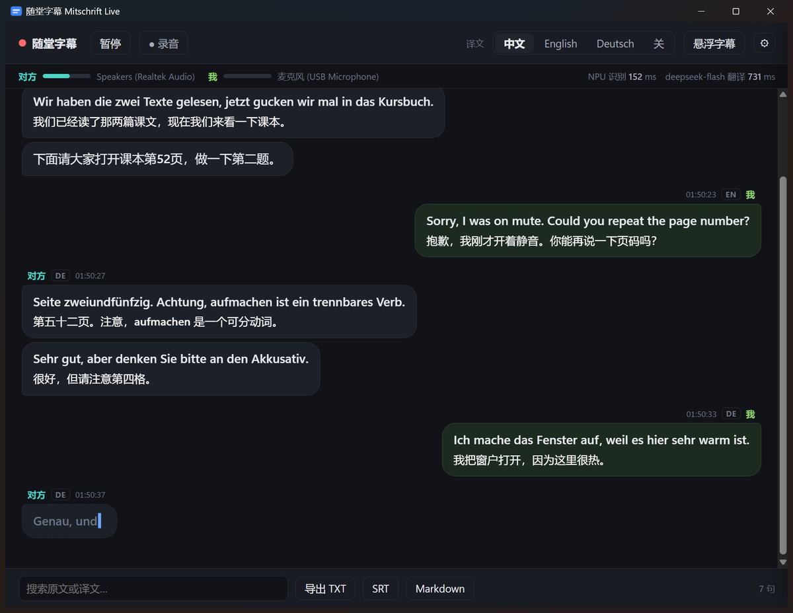
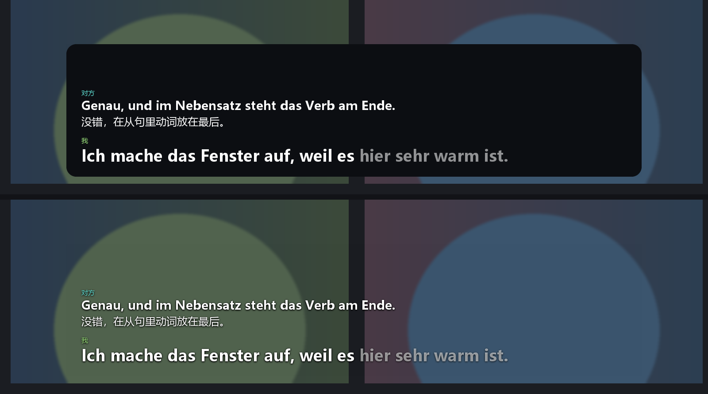

# 随堂字幕（Mitschrift Live）

Windows 上的实时字幕和翻译。它同时听电脑里播放的声音（Zoom 里的对方、网课视频）和你的麦克风，
在**本地**做语音识别，再用大模型逐句翻译。结果显示成聊天式的记录，外加一个浮在通话上方的字幕条。

*Mitschrift* 是德语里"课堂上边听边记的笔记"。它最初是为一门用 Zoom 上的德语课做的：识别德语、英语和中文，翻译成中文、英文或德文。

[English](README.md)





*悬浮字幕条。文字和背景的不透明度分开设置：默认不透明（上），也可以只留文字浮在通话上（下）。*

## 功能

- **两路声音分开显示**：系统声音（WASAPI 回环录音，"对方"）和麦克风（"我"）。
- **本地语音识别**：NVIDIA Parakeet TDT 0.6B v3（德语、英语等 25 种欧洲语言），可以跑在 NVIDIA
  显卡、Intel NPU、AMD / Intel 核显（DirectML）或 CPU 上。每句话自动判断是不是中文，中文交给
  SenseVoice Small 识别。
- **边说边出字，说完定稿**：长段独白会带一点重叠地切开，不丢字也不重复。
- **逐句翻译**：带上前几句作为上下文，并告诉模型场景（默认 *a German language class*）。
  支持 DeepSeek 和 Claude；译文可选 中文 / English / Deutsch，或关闭。
- **外放也能用**：用 WebRTC 回声消除处理麦克风（以系统声音为参考），再加一层文字级的回声过滤。
- **悬浮字幕条**：总在最上层，不抢 Zoom 的焦点；可以开"鼠标穿透"，用全局快捷键 Ctrl+Alt+L 切换；
  文字和背景的不透明度分开调。
- 自动跟随 Windows 默认设备；可以录音（双方声音 + 字幕）；导出 TXT / SRT / Markdown；托盘常驻。

声音不会离开你的电脑。发给翻译服务的只有说完的句子文字（加上前几句作为上下文）。

## 原理

```
系统声音（回环录音）───────┐
                          ├─> 16 kHz ─> Silero VAD ─> 分句器 ─┬─> Parakeet   （德 / 英 / …）
麦克风 ─> 回声消除 ────────┘                                  └─> SenseVoice （中文 + 语种识别）
                                                                       │
                              字幕 ─> 翻译（DeepSeek / Claude）─> WebSocket ─> 主窗口（WebView2）
                                                                       └─> 字幕条（原生绘制，逐像素透明）
```

- **分句器**按停顿切出一句话；说话过程中每约 0.5 秒重新识别一次（电脑慢时会自动放慢），
  超过约 12 秒强制切开，并重新听一遍最后一个词，保证两段之间不漏字。
- **语种分流**：每句话的前 2.5 秒里，由 SenseVoice 的语种识别决定交给 SenseVoice（中文）还是
  Parakeet（其他语言）。
- **主窗口**是 WebView2 里的网页，通过本机 WebSocket（随机端口 + 令牌）和 Python 后台通信。
  **字幕条**用 Pillow + numpy 自己绘制，再用 `UpdateLayeredWindow` 显示，因为 WebView2 窗口只能整体透明。

## 识别引擎实测

除特别说明外，都在开发用的电脑上测（Intel Core Ultra 9 275HX，RTX 5080 Laptop）。
"10 秒一句"指识别一段 10 秒语音的耗时；CPU 占用是两路实时模拟时占整机的比例。

| 引擎 | 硬件 | 编码器 | 10 秒一句 | CPU 占用 | 备注 |
|---|---|---|---|---|---|
| `cuda` | NVIDIA 显卡（RTX 5080 Laptop） | fp32 | 66 ms | 约 2% | 显存约 4 GB |
| `npu` | Intel NPU（Core Ultra "AI Boost"） | int8，OpenVINO | 134 ms | 0.5% | 首次启动编译约 1 分钟（之后缓存）；10 秒窗口 |
| `dml` | Intel 核显，4 个 Xe 核 | fp16，DirectML | 约 200 ms | 约 4% | 10 秒窗口 |
| `dml` | AMD Radeon 780M（用户日志） | fp16，DirectML | 约 130 ms | 约 6% | |
| `cpu` | 8 线程 | int8 | 223 ms | 约 10% | 电脑较慢时，说话过程中的刷新会变慢 |

每句翻译的延迟：DeepSeek `deepseek-flash` 中位数约 0.7 秒，Claude Haiku 约 0.9 秒。
原始数据在 `bench/results/*.json`，测法见 [`bench/README.md`](bench/README.md)。

## 环境要求

- Windows 10 / 11，64 位（在 Windows 11 上开发和测试）。需要 WebView2 运行时（Windows 11 自带）。
- Python 3.12 和 [uv](https://docs.astral.sh/uv/)。
- 翻译需要 [DeepSeek](https://platform.deepseek.com/) 或 [Anthropic](https://console.anthropic.com/) 的 API key。
  没有 key 也能出字幕，把翻译设成"关"即可。

## 从源码安装和运行

```bash
git clone <本仓库>
cd mitschrift-live
```

按硬件选一种语音运行库（`cpu` / `cuda` / `dml` 三选一，`npu` 是附加项）：

```bash
uv sync --extra cuda
```

```bash
uv sync --extra cpu
```

```bash
uv sync --extra dml
```

```bash
uv sync --extra cpu --extra npu
```

把翻译 key 设成用户环境变量（用 `setx` 设的值，程序不用重新登录也能读到）：

```bash
setx DEEPSEEK_API_KEY "sk-..."
```

启动桌面程序（`ui.bat` 会用仓库里的 `.venv`）：

```bash
ui.bat
```

其他启动方式：

- `ui.bat --demo`：脚本生成的演示字幕，不需要声音、模型和 key。
- `ui.bat --autostart`：启动后直接开始识别。
- `run.bat --engine cpu`：在终端里显示字幕（全部参数见 `run.bat --help`）。

识别引擎在程序里 ⚙ → 识别 → 引擎 选择（`run.bat` 用 `--engine`）。

### 模型

模型第一次用到时从 Hugging Face 下载到 `~/.livecapture/models`（设置 `LIVECAPTURE_HOME` 可以把
程序存的所有东西搬到别处）。在国内请先指向镜像，例如 `set HF_ENDPOINT=https://hf-mirror.com`。

| 引擎 | 下载内容 |
|---|---|
| `cpu`、`npu`、`dml` | Parakeet int8（约 0.65 GB） |
| `cuda`，以及下面的转换各需一次 | Parakeet fp32（约 2.4 GB） |
| 开启中文识别时都需要 | SenseVoice Small int8（约 0.23 GB），Silero VAD（2 MB） |

有两个引擎需要先转换一次编码器，用 `bench/` 里的脚本（先 `uv sync --group bench`）：

- `npu`：全 int8 的 OpenVINO 编码器。先生成校准语音，再量化：
  `uv run python bench/make_samples.py bench/audio_calib calib`，然后
  `uv run python bench/npu_quantize.py`。不做这一步，NPU 会用 fp16 编码器，速度慢一些。
- `dml`：fp16 编码器。`uv run python bench/to_fp16.py`（需要 fp32 模型：
  `uv run python -c "from livecapture import models; models.ensure_parakeet(None)"`）。
  不做这一步，程序会退回 CPU 识别。

## 使用

- **开始 / 暂停**；**中文 / English / Deutsch / 关**：译文语言。
- **悬浮字幕**：显示 / 隐藏字幕条。拖动字幕条本身可以移动，拖边缘可以改大小；鼠标移上去会出现
  按钮（A− A+ 译文 穿透 ×）。
- **穿透**：点击会落到下面的窗口。按 **Ctrl+Alt+L** 关闭（被占用时改用 Ctrl+Alt+C 或
  Ctrl+Alt+F12，设置里会显示实际是哪个）。
- **⚙ 设置**：识别引擎、翻译模型和场景、设备（默认跟随 Windows）、中文识别、回声消除、
  字幕条字号和文字 / 背景不透明度。
- **● 录音**：把双方声音和字幕保存到 `文档\Mitschrift Live`。
- 关闭主窗口后程序留在托盘继续运行；从托盘菜单退出。

设置和日志在 `~/.livecapture`（`settings.json`、`ui.json`、`logs/live-capture.log`）。
日志里只有耗时和错误信息，没有说话内容。

## 目录结构

项目最初叫 *Live Capture*；Python 包名（`livecapture`）、数据目录（`~/.livecapture`）和安装程序的
AppId 都沿用旧名，这样已经装好的版本可以直接升级。


```
livecapture/      程序本体
  app.py            桌面外壳：主窗口、字幕条、托盘、全局快捷键
  server.py         后台：设置、模型加载、WebSocket、状态和速度日志
  pipeline.py       声音来源 -> 分句器 -> 翻译，可重启
  audio.py, vad.py  WASAPI 采集（回环 + 麦克风），Silero VAD
  segmenter.py      分句、实时结果、强制切分、语种分流
  stt.py            Parakeet：cuda / npu / dml / cpu
  sensevoice.py     中文识别 + 语种识别
  echo.py           回声消除和回声过滤
  translate.py      DeepSeek / Claude 翻译
  caption_bar.py    原生悬浮字幕条
  __main__.py       命令行版本（run.bat）
ui/               主窗口（HTML / JS）；overlay.html 用于在浏览器里预览字幕条
bench/            设计决策背后的测速和实验脚本
tests/            单元测试（uv run --group dev pytest）
build/            Windows 安装包工具（见下）
```

## 打包 Windows 安装包

`build/build_friends.py` 生成一个自带运行环境的文件夹（官方嵌入版 Python、依赖包、模型），
并用 [Inno Setup 6](https://jrsoftware.org/isinfo.php) 打成安装包，分三个版本：`--edition cpu`、
`npu`（Intel NPU，失败退回 CPU）、`amd`（DirectML，失败退回 CPU）。`--patch` 生成只替换代码的小更新包。

这些安装包会内嵌 `FRIENDS_DEEPSEEK_KEY` 里的 DeepSeek key，方便朋友不注册账号直接用。key 只做了混淆，
拿到安装包的人都能取出来：只发给信任的人，用一个单独的、设了消费上限的 key，并且不要公开发布这类安装包。

## 已知限制

- 只支持 Windows（WASAPI 回环录音、Win32 窗口、DirectML）。
- 界面只有中文。
- 一种语言的句子里夹杂另一种语言的词（比如中文里夹德语词），常常识别不准。
- `npu` 和 `dml` 引擎用固定的 10 秒窗口，长句会被切成 10 秒以内的几段。
- DirectML 上 int8 比 fp16 慢；而且把窗口声明成固定形状会算出错误结果（ONNX Runtime 1.24），
  所以代码改用补零。
- 安装包没有代码签名，Windows SmartScreen 会提示风险。

## 许可证

随堂字幕自己的代码使用 MIT 许可证，见 [`LICENSE`](LICENSE)。模型和依赖各有自己的许可证
（Parakeet：CC BY 4.0），见 [`THIRD_PARTY_NOTICES.md`](THIRD_PARTY_NOTICES.md)。
